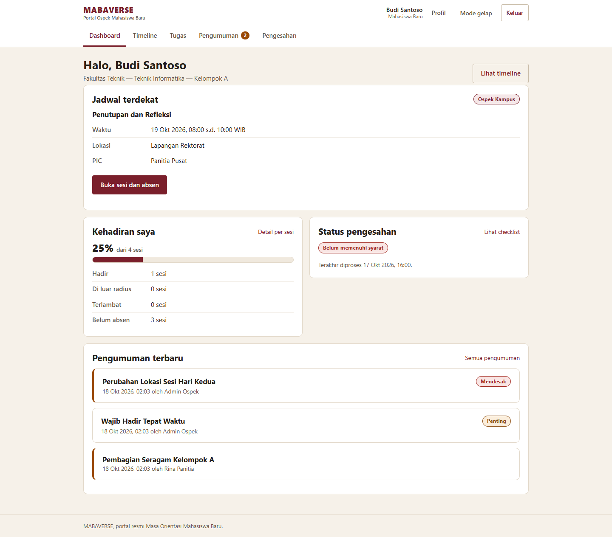
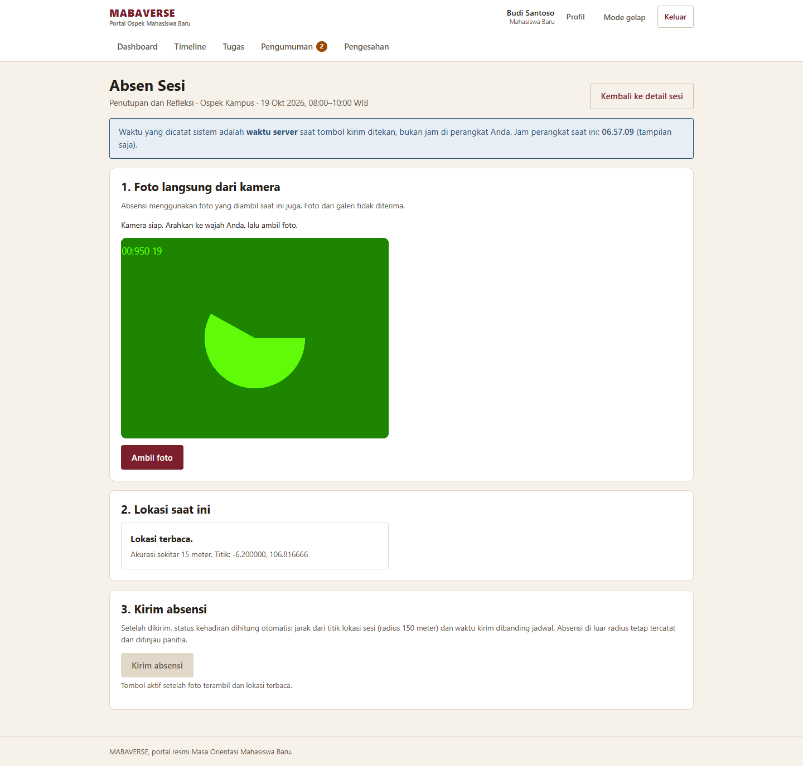
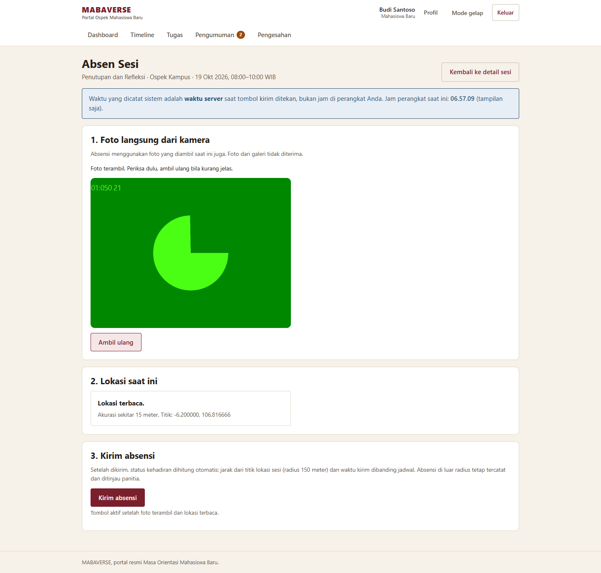
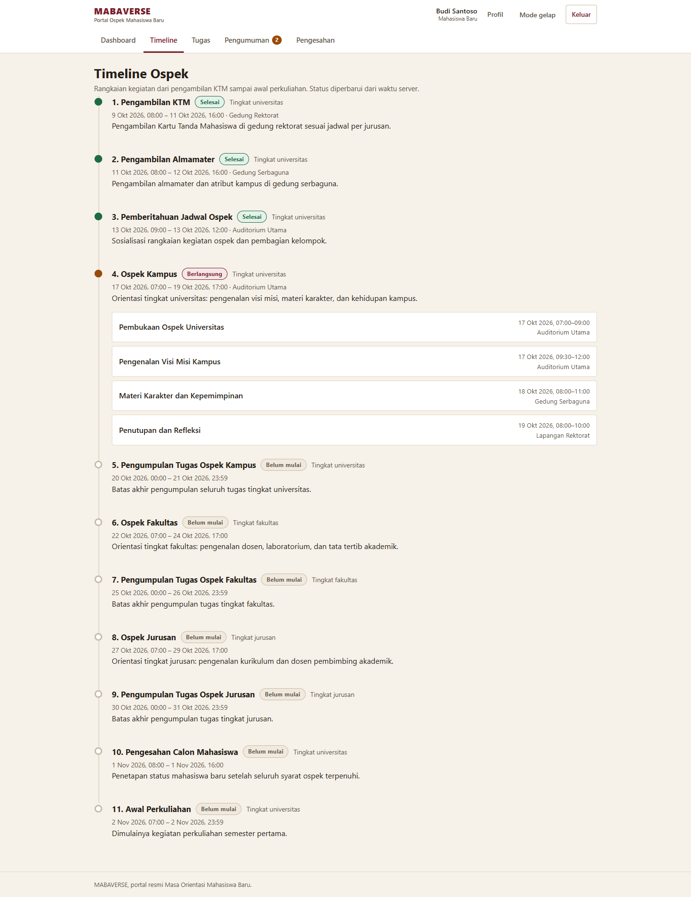
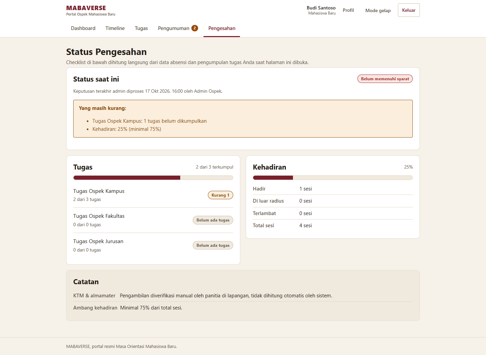
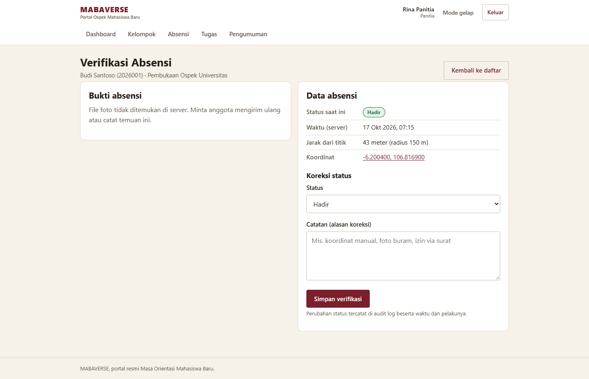
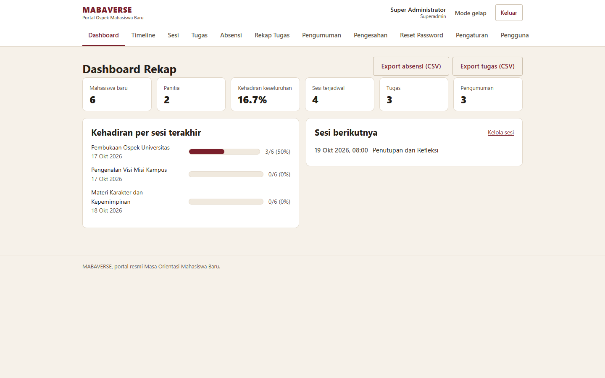
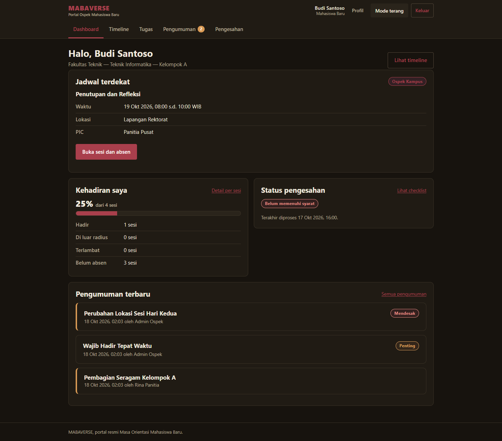
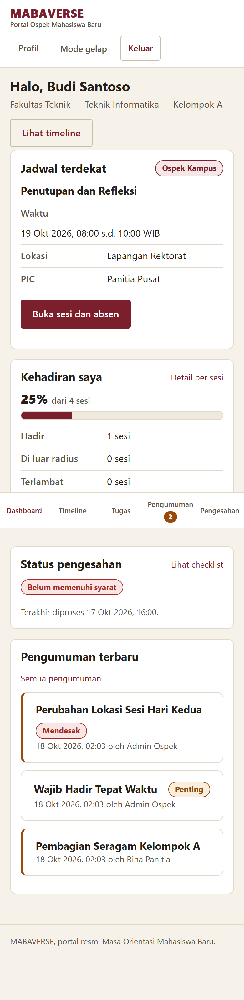

# MABAVERSE

Portal ospek terpusat untuk kampus: jadwal, absensi dengan foto dan validasi lokasi, tugas, pengumuman, pengesahan mahasiswa baru, dan rekap untuk panitia serta admin.



## Fitur

**Mahasiswa baru**: dashboard dengan jadwal terdekat dan status pengesahan, timeline tahap dan sesi, absensi foto kamera dengan deteksi jarak dari titik sesi, pengumpulan tugas dengan batas format dan ukuran, pengumuman bertarget, riwayat tugas, pengesahan mandiri, profil, dan ubah password.

**Panitia**: dashboard kelompok binaan, daftar sesi, verifikasi absensi dengan koreksi status dan catatan, review pengumpulan tugas kelompok binaan, dan pengumuman untuk kelompoknya.

**Admin ospek**: statistik dan tren kehadiran, kelola timeline (dengan pengurutan), sesi (titik lokasi dan radius), tugas bertarget fakultas/jurusan/kelompok, pengumuman, rekap absensi dan tugas dengan filter serta export CSV, proses pengesahan massal atau per mahasiswa, token reset password, pengaturan ambang kehadiran, dan audit log.

**Superadmin**: seluruh menu admin, ditambah kelola pengguna dan import massal mahasiswa baru via CSV.

## Tampilan

### Absensi dari kamera, dengan validasi waktu dan lokasi

Foto wajib diambil langsung dari kamera, bukan dari galeri. Server menghitung jarak ke titik sesi dan membandingkan waktu kirim dengan jadwal. Absensi di luar radius tetap tercatat untuk ditinjau panitia.

| Kamera aktif | Foto terambil dan siap dikirim |
| --- | --- |
|  |  |

### Timeline, pengumuman, dan pengesahan mandiri

| Timeline tahap ospek | Checklist pengesahan |
| --- | --- |
|  |  |

### Verifikasi panitia dan rekap admin

Panitia memverifikasi absensi dan tugas kelompok binaan. Admin memantau kehadiran, mengelola data ospek, dan mengunduh rekap CSV.

| Verifikasi absensi oleh panitia | Dashboard admin |
| --- | --- |
|  |  |

### Mode gelap dan tampilan mobile

Tema gelap dipilih dari topbar dan kedua mode berfungsi penuh. Maba memakai aplikasi lewat HP dengan navigasi bawah.

| Mode gelap | Tampilan mobile |
| --- | --- |
|  |  |

Screenshot seluruh halaman (publik, maba, panitia, admin, mode gelap, mobile, dan halaman error) ada di folder [`screenshots/`](screenshots).

## Teknologi

- PHP native 8.1+ dan MySQL/MariaDB via PDO, tanpa framework dan tanpa library eksternal.
- MVC sederhana: satu front controller (`index.php`) dengan tabel rute, controller per peran, model per tabel, dan view per halaman.
- Tanpa aset eksternal: satu stylesheet dan skrip kecil per halaman yang butuh.
- Keamanan: password bcrypt, CSRF token per sesi, CSP dengan nonce, header `nosniff` dan `X-Frame-Options`, cookie sesi `secure` di produksi, serta `.htaccess` di folder sensitif.

## Cara menjalankan (XAMPP)

Kebutuhan: XAMPP dengan PHP 8.1+ dan MySQL/MariaDB, serta Apache dengan `mod_rewrite` aktif (bawaan XAMPP).

1. Letakkan folder ini di `C:\xampp\htdocs\MABAVERSE` (nama folder harus sama karena `RewriteBase` diatur ke `/MABAVERSE/`).
2. Jalankan Apache dan MySQL dari XAMPP Control Panel.
3. Buka `http://localhost/MABAVERSE/install.php`, lalu klik "Pasang sekarang". Installer membuat database `mabaverse`, menjalankan `database/schema.sql`, lalu mengisi `database/seed.sql`.
4. Installer menulis `config/installed.lock` setelah sukses. Untuk memasang ulang dari nol, hapus file lock itu lebih dulu.
5. Di server produksi, hapus `install.php` setelah instalasi selesai.

Import manual: buat database `mabaverse` di phpMyAdmin, lalu import `database/schema.sql` dan `database/seed.sql` secara berurutan.

## Akun demo

Semua akun memakai password `admin123`.

| NIM/ID | Role | Keterangan |
| --- | --- | --- |
| `ADMIN001` | superadmin | seluruh menu admin termasuk kelola pengguna |
| `ADM001` | admin | timeline, sesi, tugas, pengumuman, rekap, pengesahan |
| `PAN001` | panitia | pembina Kelompok A |
| `PAN002` | panitia | pembina Kelompok B |
| `2026001` s.d. `2026006` | maba | mahasiswa baru contoh |

Data contoh memakai tanggal relatif terhadap hari instalasi, jadi linimasa demo selalu terlihat berjalan: ada tahap yang sudah selesai, sesi kemarin dengan rekap absensi terisi, sesi hari ini yang masih kosong untuk uji coba alur absensi, dan sesi besok yang akan datang.

## Konfigurasi produksi

1. Salin `config/config.sample.php` menjadi `config/config.local.php`.
2. Isi `BASE_URL` (https), `DB_HOST`, `DB_USER`, `DB_PASS`, `DB_NAME`, dan biarkan `APP_ENV` bernilai `production`.

Saat `APP_ENV = 'production'`, aplikasi otomatis mematikan `display_errors` dan menulis error ke `logs/php-error.log`, memakai cookie sesi dengan flag `secure` dan `httponly`, mengirim header HSTS, dan menampilkan halaman 500 generik tanpa path server.

## Backup harian

`backup.php` menjalankan `mysqldump` ke folder `backups/` dengan nama file bertimestamp (mis. `backups/mabaverse_20261018_230000.sql`). Script hanya bisa dijalankan dari CLI, memakai kredensial dari `config/config.local.php` (atau default XAMPP), dan menghapus file sisa bila backup gagal.

```
C:\xampp\php\php.exe C:\xampp\htdocs\MABAVERSE\backup.php
```

Windows Task Scheduler (contoh harian pukul 23:00):

```
schtasks /Create /SC DAILY /ST 23:00 /TN "MABAVERSE Backup" /TR "C:\xampp\php\php.exe C:\xampp\htdocs\MABAVERSE\backup.php"
```

Cron Linux (contoh harian pukul 23:00):

```
0 23 * * * cd /var/www/MABAVERSE && /usr/bin/php backup.php >> logs/backup.log 2>&1
```

## Catatan

- Email reset password belum dikonfigurasi. Alur lupa password membuat token di tabel `password_reset_tokens`; admin membuka `admin/reset-permintaan` untuk melihat tautan aktif (berlaku 1 jam) dan menyalurkannya secara manual.
- Waktu dan tenggat selalu memakai jam server (`waktu_submit_server`). Jam perangkat hanya tampilan di halaman absensi.
- Lokasi absensi memakai GPS perangkat. Bila GPS gagal, ada isian koordinat manual, dan absensinya ditandai untuk ditinjau panitia.
- Ekstensi file unggahan ditentukan server dari hasil verifikasi isi file, bukan dari nama file kiriman pengguna. Ukuran file mengikuti pengaturan per tugas, tetap dibatasi maksimal 10 MB.
- Ambang kehadiran pengesahan disimpan di tabel `pengaturan` (bawaan 75%) dan bisa diubah admin lewat `admin/pengaturan`.
- Import CSV maba memakai urutan kolom `nim,nama,email,password,fakultas_id,jurusan_id,kelompok_id,no_kontak_darurat` dengan baris pertama sebagai header. Password kosong memakai default `mabaverse123`.

## Struktur folder

```
MABAVERSE/
├── index.php            # front controller + tabel rute
├── install.php          # installer database (terkunci otomatis + hapus setelah dipakai di produksi)
├── backup.php           # backup database via mysqldump (CLI saja)
├── .htaccess            # rewrite ke index.php
├── .gitignore           # daftar file yang tidak ikut di-commit
├── config/              # config umum (helper), config.sample.php, koneksi database
├── controllers/         # Auth, Maba, Panitia, Admin, Api, Base
├── models/              # User, Timeline, Tugas, Absensi, Pengumuman, Pengesahan, Pengaturan
├── views/               # tampilan per peran (maba, panitia, admin, auth, layouts, errors)
├── assets/              # css dan js
├── utils/               # handler upload
├── database/            # schema.sql dan seed.sql
├── screenshots/         # dokumentasi tampilan seluruh halaman
├── logs/                # log error produksi (diproteksi .htaccess)
├── backups/             # hasil backup database (diproteksi .htaccess)
└── uploads/             # hasil unggahan (absensi, tugas, profil)
```
